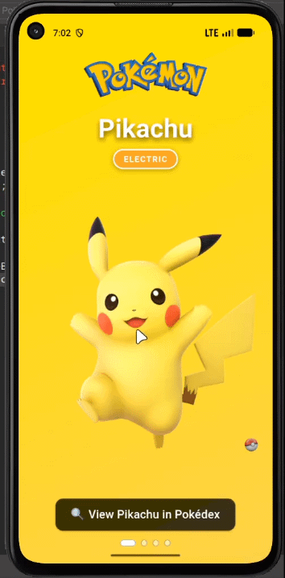
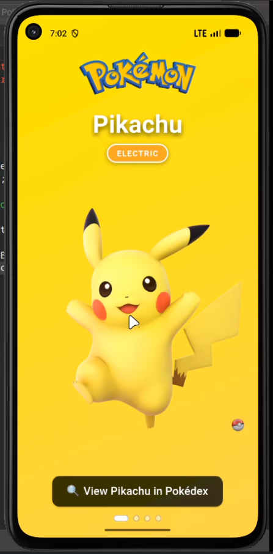
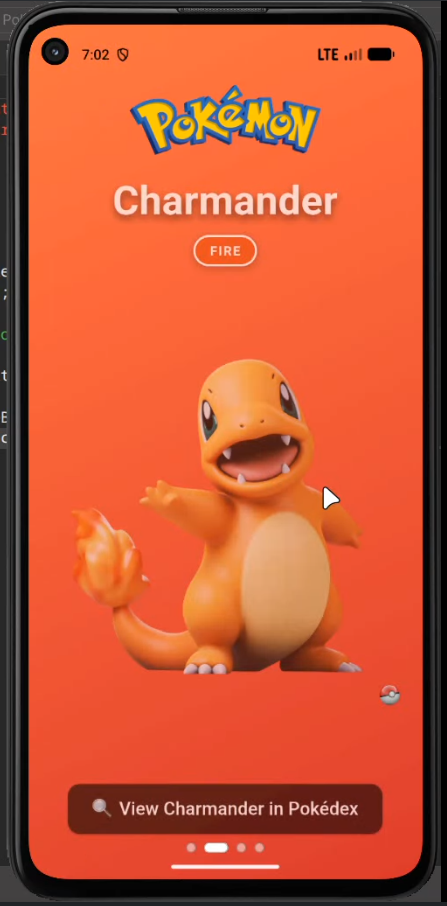
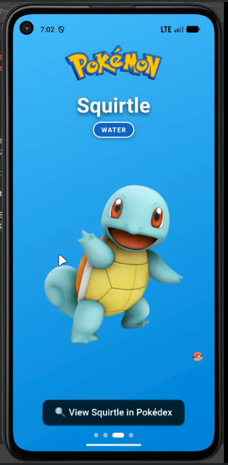
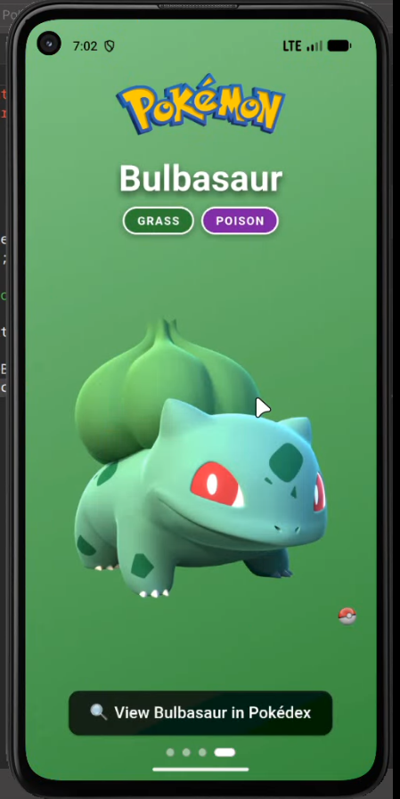
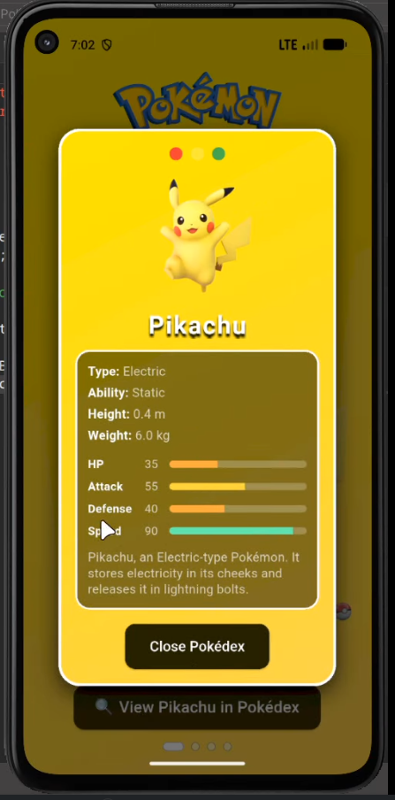

<div align="center">


# Pokémon Swipe

**A Flutter Pokémon showcase with liquid swipe transitions, animated Pokédex cards, type badges, and base-stat bars.**

[](https://github.com/HammasT1/flutter_pokemon_card_swipe/actions/workflows/ci.yml)


[**View on GitHub**](https://github.com/HammasT1/flutter_pokemon_card_swipe) · [Report an issue](https://github.com/HammasT1/flutter_pokemon_card_swipe/issues)

</div>

---

## 🎬 Preview

<div align="center">



</div>

## ✨ Features

| | Feature | Description |
|---|---|---|
| 🌊 | **Liquid swipe navigation** | Move between Pokémon with a fluid, liquid-reveal page transition and a Poké Ball swipe handle. |
| 🎬 | **Entry animations** | The name, image, and button slide and fade in each time a page becomes active. |
| 🏷️ | **Type badges** | Color-coded chips for each type, including dual types like Grass / Poison. |
| 📖 | **Pokédex dialog** | An animated card with type, ability, height, weight, and a short description. |
| 📊 | **Base-stat bars** | HP, Attack, Defense, and Speed bars that fill in when the Pokédex opens. |
| 🔘 | **Page indicator** | Dots show your position, and tapping one jumps straight to that Pokémon. |
| 🎨 | **Themed gradients** | Each Pokémon has its own background gradient that matches its type. |

## 📸 Screenshots

<div align="center">

<table>
  <tr>
    <td align="center"><b>Front Screen</b><br></td>
    <td align="center"><b>Front Screen 2</b><br></td>
    <td align="center"><b>Front Screen 3</b><br></td>
    <td align="center"><b>Front Screen 4</b><br></td>
  </tr>
  <tr>
    <td colspan="4" align="center"><b>Pokémon Card</b><br></td>
  </tr>
</table>

</div>

## 🚀 Getting Started

### Prerequisites

- [Flutter SDK](https://docs.flutter.dev/get-started/install) (stable channel)
- Android Studio with an Android emulator, or a physical device
- VS Code with the Flutter extension (optional)

### Run it

```bash
git clone https://github.com/HammasT1/flutter_pokemon_card_swipe.git
cd flutter_pokemon_card_swipe
flutter pub get
flutter run
```

In **VS Code**, pick your emulator in the status bar and press **F5** (or ▶ Run). The included `.vscode/launch.json` provides debug and profile configurations.

### Download the APK

Every push to `main` builds an APK, which you can download from the run's **Artifacts** on the [Actions](https://github.com/HammasT1/flutter_pokemon_card_swipe/actions) tab. Pushing a version tag (e.g. `v1.0.0`) publishes the APK on the [Releases](https://github.com/HammasT1/flutter_pokemon_card_swipe/releases) page.

## 🗂️ Project Structure

```
lib/
├── main.dart                  # App entry point
├── data/
│   └── pokemon_data.dart      # Pokémon list: info, stats, gradients
├── models/
│   └── pokemon_model.dart     # PokemonModel class
├── screens/
│   └── pokemon_screen.dart    # LiquidSwipe screen + page indicator
├── widgets/
│   ├── pokemon_page.dart      # Animated page for a single Pokémon
│   ├── type_badge.dart        # Color-coded type chip
│   ├── stat_bar.dart          # Animated base-stat bar
│   └── page_indicator.dart    # Tappable page dots
├── dialogs/
│   └── pokemon_dialog.dart    # Pokédex info dialog
└── theme/
    └── app_colors.dart        # Gradients and type colors
```

## ➕ Adding a Pokémon

1. Put the image in `assets/images/`.
2. Add a `PokemonModel` entry to `lib/data/pokemon_data.dart`:

```dart
PokemonModel(
  name: "Eevee",
  image: "assets/images/eevee.png",
  type: "Normal",
  ability: "Run Away",
  height: "0.3 m",
  weight: "6.5 kg",
  description: "Eevee, the Evolution Pokémon. Its unstable genes let it evolve in many ways.",
  gradient: AppColors.yellowGradient,
  stats: {"HP": 55, "Attack": 55, "Defense": 50, "Speed": 55},
),
```

3. If it has a new type, add a color for it to `typeColors` in `lib/theme/app_colors.dart`. Otherwise its badge shows up grey.

## 🛠️ Built With

- [Flutter](https://flutter.dev) & [Dart](https://dart.dev)
- [liquid_swipe](https://pub.dev/packages/liquid_swipe) for the page transitions

## 👤 Author

**Muhammad Hammas Rasheed**: [@HammasT1](https://github.com/HammasT1)

If you like this project, give it a ⭐ on [GitHub](https://github.com/HammasT1/flutter_pokemon_card_swipe)!

## 📄 License

The source code is released under the MIT License. See [LICENSE.md](LICENSE.md) for details.

> **Disclaimer:** This is a non-commercial fan project. Pokémon and all related names, characters, and images are trademarks and © of Nintendo, Game Freak, and The Pokémon Company. This project is not affiliated with or endorsed by them.
